# Hi there, I'm Priyanka Das! 👋

<!-- Theme-Sensitive Header Banner -->
<picture>
  <source media="(prefers-color-scheme: dark)" srcset="readmefile/dark.svg">
  <source media="(prefers-color-scheme: light)" srcset="readmefile/light.svg">
  
</picture>

 

## 🚀 About Me
I’m **Priyanka Das**, a **Full-Stack Developer** specializing in **React** and **Node.js**, based in **Maldah, West Bengal, India**. I enjoy building clean, maintainable products from the user interface all the way to the API.

I’m deeply passionate about **AI integration** — bringing intelligent features into real-world applications — and about **effective global communication**, so ideas move smoothly across teams, time zones and cultures.

- 🌐 **Web:** Full-stack apps with React and Node.js.
- 🤖 **AI Integration:** Adding AI-powered features to modern applications.
- 🧼 **Clean Code:** Readable, maintainable and well-structured code.
- 💬 **Ask me about:** React, Node.js, AI integration, clean code, or working effectively with global teams.
- 📍 **Location:** kolkata, West Bengal, India
- ✉️ **Contact:** [pakhidas949@gmail.com](mailto:pakhidas949@gmail.com)
- 🐙 **GitHub:** [@pakhidas949-lab](https://github.com/pakhidas949-lab)

---

## 🛠️ Technical Skills

### 💻 Languages

### 🖥️ Frontend & Creative

### ⚙️ Backend & API

### 🗄️ Databases & BaaS

### 🤖 AI & Automation

---

## 📈 GitHub Stats & Metrics

<!-- Sleek contribution activity graph with theme sensitivity -->

  <picture>
    <source media="(prefers-color-scheme: dark)" srcset="https://activity-graph.vercel.app/graph?username=pakhidas949-lab&bg_color=030712&color=94A3B8&line=10B981&point=34D399&area_color=0D9488&area=true&hide_border=true&radius=12">
    <source media="(prefers-color-scheme: light)" srcset="https://activity-graph.vercel.app/graph?username=pakhidas949-lab&bg_color=FFFFFF&color=475569&line=0D9488&point=10B981&area_color=E6FFFA&area=true&hide_border=true&radius=12">
    
  </picture>

<!-- Side-by-Side Stats Cards with theme sensitivity -->

  <!-- GitHub Stats Card -->
  <picture>
    <source media="(prefers-color-scheme: dark)" srcset="https://ghstats.dev/api/card?username=pakhidas949-lab&bg=030712&title_color=10B981&text=94A3B8&icon_color=34D399&border_color=0D9488">
    <source media="(prefers-color-scheme: light)" srcset="https://ghstats.dev/api/card?username=pakhidas949-lab&bg=FFFFFF&title_color=0D9488&text=475569&icon_color=10B981&border_color=E2E8F0">
    
  </picture>

  <!-- Streak Stats -->
  <a href="https://github.com/pakhidas949-lab" target="_blank">
    <picture>
      <source media="(prefers-color-scheme: dark)" srcset="https://streak-stats.demolab.com?user=pakhidas949-lab&theme=dark&background=030712&stroke=0D9488&ring=10B981&fire=34D399&currStreakNum=10B981&currStreakLabel=94A3B8&sideNums=94A3B8&sideLabels=94A3B8&dates=6B7280">
      <source media="(prefers-color-scheme: light)" srcset="https://streak-stats.demolab.com?user=pakhidas949-lab&theme=light&background=FFFFFF&stroke=E2E8F0&ring=0D9488&fire=10B981&currStreakNum=0D9488&currStreakLabel=475569&sideNums=475569&sideLabels=475569&dates=94A3B8">
      
    </picture>
  </a>
  

---

  ⭐ <b>If you like this profile README, please consider leaving a star to show your support!</b> ⭐

---

  Designed, thought, and developed with 💚 by <a href="https://github.com/pakhidas949-lab" target="_blank"><b>Priyanka Das</b></a> 
  Clean code, thoughtful AI integration, and clear communication — one commit at a time.

